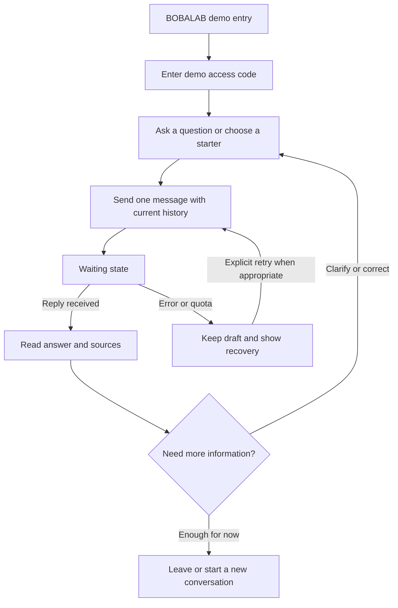

# BOBALAB — interface and visual identity brief

Status: ready for specialist design; not an implemented UI. Prepared 28 October
2026 from the current code and the candidate's recorded decisions.

## 1. Identity and purpose

**Website name and primary wordmark: BOBALAB.** Preserve this exact name. Do not
invent an alternative brand, unrelated assistant persona or named chatbot.
An explanatory subtitle such as "Visa support demo" is allowed; it is not a new
product name. Browser title proposal: "BOBALAB | Visa support demo".

Build a usable browser entry point to the working Thai DTV support API for this
take-home assessment. Help a person understand their immediate concern, available
information, uncertainty and next step. The interface should make it easy to read
and continue a conversation without suggesting real visa processing is occurring.

This is an assessment demonstration using synthetic enquiries, limited reviewed
sources and sample agency information. It is not an official embassy service or
a confirmed operating immigration agency. Human, approachable writing must not
misrepresent the assistant as a human consultant.

## 2. Decisions and authority

| Status | Decision |
|---|---|
| User-confirmed | Name BOBALAB; CI means visual brand identity |
| User-confirmed | Add a browser interface; prepare requirements for a specialist LLM |
| User-confirmed | Concern-first support; clear sources, practical options and tradeoffs |
| User-confirmed | Describe options, then offer a recommendation conditional on known priorities |
| User-confirmed | Less adamant tone; uncertainty; useful continuation or invitation to correct |
| User-confirmed | Strictly free services; accept limits and slow starts |
| Existing constraint | Automatic learning edits behavior, not facts/model weights; all three APIs remain |
| Proposed | One customer chat screen and About panel; access-code gate; English UI with English/Thai chat support |
| Proposed | Calm warm-neutral/green palette; IBM Plex typography; responsive flat conversation layout |
| Not provided | Official logo files, official brand colours or a BOBALAB brand manual |

The earlier API-only choice is historical; this request expands the scope. The
designer must distinguish proposed visual choices from user-approved decisions.

## 3. Users and immediate needs

Primary user: a person trying a synthetic visa enquiry, often uncertain about
preparation, timing, costs or what the assistant can actually do. They may write
in English or Thai, use a phone, and be unfamiliar with technical language.

Secondary user: an assessor testing the service and reading the evidence. Keep
their documentation/evidence access separate from the customer's conversation.
Do not put system prompts, training controls, raw JSON or internal model metrics
in the customer flow. A read-only documentation link can serve assessors.

## 4. Minimum browser release

### Required customer-facing features

- Responsive chat with readable English/Thai input/output and current-thread context.
- Clear demo access entry, using a future server-side browser session rather than
  exposing the privileged reviewer API key. See the technical appendix.
- Empty state with a short invitation and a few optional starter questions.
- Text composer, explicit Send, multiline support and visible pending state.
- One request at a time, preserving the draft on error and preventing duplicate sends.
- Faithful display of the actual aiReply, including line breaks and uncertainty.
- Safe, clickable source links when the reply contains them. No "verified answer" badge.
- Clear recovery for access expiry, input limits, unavailable service and quotas.
- New conversation/reset with confirmation when it would discard the current thread.
- About panel describing scope, AI/demo status, source limits and data handling.
- Copy reply action with success/failure feedback, if it fits the core layout.

### Outside the minimum release

- Document uploads/inspection, payment checks, bookings or application submissions.
- Live-agent transfer, staff notifications or promised follow-up.
- Accounts, saved conversation lists, cross-device history, analytics or persistent chat storage.
- Voice, live translation, file export, marketing funnels or a full content website.
- Live search, visa eligibility calculators, approval scores or application trackers.
- Public automatic/manual prompt-edit controls or rollback buttons.
- Simulated token streaming: the existing API returns one complete JSON response.

Optional later: a protected reviewer workspace that calls the two improvement
endpoints and shows prediction, actual change, status and versions. It needs a
separate authorization design and is not needed for the customer chat release.

## 5. Customer journey

| Stage | Customer need | UI behavior | Real system boundary |
|---|---|---|---|
| Arrive | Understand what this is | BOBALAB name, short scope/demo note, access entry | No operational agency or embassy identity implied |
| Enter | Try without a long onboarding form | Demo access code; then question or starter | Browser session is proposed, not implemented |
| Ask | Explain the immediate concern | Composer; retain known details in current thread | Client sends history with each request |
| Wait | Know the request is in progress | Honest pending state and slow-service message | No known progress percentage or guaranteed ETA |
| Read | Understand the answer and its limits | Clear text, relevant sources, readable spacing | Model behavior is imperfect; UI must not invent missing content |
| Decide | Compare useful paths | Show actual comparisons and conditional reasoning when present | No fabricated recommendation cards or eligibility conclusion |
| Clarify | Correct a constraint or ask more | Continue in the same thread | Keep exact request/response ordering |
| Act or leave | Know a feasible next step | Preparation/checking guidance as actually given; reset or close | No booking, submission or team contact takes place |



No application-progress bar should be inferred from this journey. It describes
information use, not tracked operational milestones or customer conversion.

## 6. Information hierarchy

| Kind of enquiry | Intended content order |
|---|---|
| Simple definition | Answer, then an essential qualification if needed |
| Practical choice | Main constraint, relevant option tradeoffs, conditional recommendation, useful next step |
| Missing material information | What can be said, what is uncertain, focused clarification |
| Unavailable action | Acknowledge, relevant capability limit, feasible route to verification |

Recommendations should explain the connection to the customer's stated priorities
and leave room for a material correction. Do not repeat known priorities merely to
ask for agreement. A closing question is useful only when it supports continuation.

These are product intentions, not guaranteed structured backend fields. Earlier
hierarchy prompt experiments were rolled back after mixed results. The UI must
not silently rewrite, reorder, strengthen or add to model advice to make it look
as though learning succeeded. Essential uncertainty stays visible, not behind
a collapsed disclosure. New rendering behavior requires separate verification.

## 7. Screen inventory and low-fidelity layouts

### S1 — Demo access

BOBALAB wordmark, "Visa support demo", concise explanation, labeled access-code
field, Show/hide code control and "Open demo" action. Provide a useful invalid-code
message and the route to the code the reviewer was privately given. Do not ask for
Gemini, database or privileged reviewer keys. No new account or identity documents.

### S2 — Empty chat / desktop

```text
┌────────────────────────────────────────────────────────────────────┐
│ BOBALAB   Visa support demo                   About   New chat     │
├────────────────────────────────────────────────────────────────────┤
│ AI demo · Use made-up examples. Don't send personal documents.      │
│                                                                    │
│             What would you like to understand?                     │
│             Ask about preparation, timing or a concern.            │
│                                                                    │
│       [What is the DTV generally for?] [Planning my next step]      │
│                                                                    │
│        ┌───────────────────────────────────────────────────┐       │
│        │ Ask your question…                               │       │
│        │                                            Send  │       │
│        └───────────────────────────────────────────────────┘       │
│            AI can make mistakes. Check relevant sources.           │
└────────────────────────────────────────────────────────────────────┘
```

Starters prefill the composer; they do not spend a model call before Send. Proposed
starters should be neutral enquiries, not promises such as "Check my payment".

### S3 — Active chat / desktop

```text
┌────────────────────────────────────────────────────────────────────┐
│ BOBALAB   Visa support demo                   About   New chat     │
├────────────────────────────────────────────────────────────────────┤
│ Demo notice remains discoverable without dominating every reply.   │
│                                                                    │
│                  Customer question in a restrained tinted bubble   │
│                                                                    │
│ BOBALAB assistant                                                  │
│ Actual answer, readable paragraphs and any options it supplied.     │
│ Important uncertainty remains in the conversation.                 │
│ Sources mentioned: readable title/link when provided                │
│ [Copy reply]                                                       │
│                                                                    │
│        ┌───────────────────────────────────────────────────┐       │
│        │ Follow up or clarify…                            │       │
│        │                                            Send  │       │
│        └───────────────────────────────────────────────────┘       │
└────────────────────────────────────────────────────────────────────┘
```

Use a centered, restrained reading column, approximately 680–760 px on a large
screen, with breathing room. Prefer flat assistant text and subtle user bubbles
over cards inside cards. A sidebar is optional; do not invent saved chat history.

### S4 — Mobile

```text
┌───────────────────────────────┐
│ BOBALAB              About ⋯  │
│ Visa support demo             │
├───────────────────────────────┤
│ Compact demo/privacy note     │
│                               │
│          Customer question    │
│                               │
│ BOBALAB assistant             │
│ Readable answer and caveats   │
│ Sources mentioned            │
│                               │
├───────────────────────────────┤
│ Follow up…                    │
│                         Send  │
└───────────────────────────────┘
```

Composer stays usable with the mobile keyboard and safe area. Avoid narrow split
panes and horizontally scrolling option tables. Confirm reset on a populated
thread. Keep essential uncertainty visible when the keyboard is open.

### S5 — About / source information panel

Explain AI/demo status, limited reviewed sources, no operational integrations and
synthetic-data use. Distinguish model-provider handling from the app's proposed
in-memory chat behavior. A source being an official URL does not verify every
claim or imply endorsement. Offer documentation/evidence links in a secondary area.

### Required variants for S2–S4

Empty; draft; sending; slow response; received; no cited sources; long response;
Thai/mixed-language response; retryable error; access expired; rate limited;
daily allowance exhausted; input/history limit; reset confirmation; narrow viewport.

## 8. Visual brand identity proposal

Brand character: clear, attentive, calm and capable. The interface should make a
complicated question feel manageable. It should look like a support product rather
than a visa advertisement or a technical lab dashboard.

- Name: BOBALAB, consistently capitalized.
- Wordmark proposal: clean typographic BOBALAB; text-only is acceptable initially.
- Any new symbol must remain subordinate to the name. No unrelated mascot/name.
- Do not fabricate an official lab logo or copy government seals, passport stamps,
  approval emblems, national insignia or another service's identity.
- No claims of government affiliation, legal-team availability or success rates.
- Avoid stock travel photos, large promotional heroes and decorative elements that
  displace the conversation. Illustrations are optional, not required assets.

Proposed palette; exact machine-readable values are in design-tokens.json:

| Role | Proposed value | Intended use |
|---|---|---|
| Background | #F7F6F2 | Warm, quiet app canvas |
| Surface | #FFFFFF | Composer/panel backgrounds |
| Main text | #182B29 | Headings and conversation |
| Secondary text | #51645F | Supporting labels, readable metadata |
| Primary | #1D5D4F | Send/action/focus; not a claim of answer verification |
| Gentle tint | #DDECE6 | User message background |
| Decorative border | #D7E1DC | Nonessential separators only |
| Control border | #6B7F76 | Essential input/control boundaries |
| Error text | #A32935 | Errors with text/icon, not colour alone |
| Notice text | #795300 | Caution/uncertainty notices with written explanation |

Selected contrast pairs are computed separately. Any palette revision must be
rechecked; the calculation is not a complete accessibility certification.

## 9. Fonts and typography proposal

Use **IBM Plex Sans** for Latin UI and **IBM Plex Sans Thai Looped** for Thai.
Proposed weights: 400 body, 500 labels, 600 headings/actions. This pairing keeps
the family coherent while allowing Thai text to be checked for legibility.

Official availability: [IBM Plex repository](https://github.com/IBM/plex) and
[IBM typeface reference](https://www.ibm.com/design/language/typography/typeface/).
The upstream [font license](https://github.com/IBM/plex/blob/master/LICENSE.txt)
is Open Font License 1.1. Preserve its license/notices with redistributed font
files. The packet names the fonts; it does not bundle font files or a final logo.

Implementation proposal: self-host only the required WOFF2 faces, use font-display
swap, and keep a system fallback. No paid fonts or mandatory third-party font call.
English stack: IBM Plex Sans, IBM Plex Sans Thai Looped, system-ui, sans-serif.
For Thai-language content, place the Thai Looped family first and test mixed text.

| Element | Proposed size / line height |
|---|---|
| Initial invitation | 28–32 px / 1.2; smaller on mobile |
| App headings | 24 px / 1.3 |
| Conversation | 17 px / 1.6; Thai may need 1.75 after rendering checks |
| Form labels/buttons | 16 px / 1.4 |
| Secondary metadata | 14 px / 1.5 |

Use zero added letter spacing for Thai. Test combining marks, wrapping and real
English/Thai fixtures. No clipping or tiny source captions. Numeric sizes and font
choices are proposals; actual browser and native-language review are still required.

## 10. Style and components

- 4/8 px spacing rhythm; 16 px minimum mobile side padding; generous paragraph spacing.
- Restrained rounded corners: about 8 px controls, 12 px messages/panels.
- Minimal shadows; visible borders where needed; no gradient-heavy dashboard shell.
- Clear text labels, visible keyboard focus and disabled/sending states.
- Primary actions about 44 px high as a product usability target, distinct from
  WCAG's smaller minimum target criterion and its exceptions.
- Motion is functional and short; respect reduced-motion preferences. No simulated
  streaming, fake progress percentages or large theatrical animations.

Required components: app header/wordmark, demo notice, access form, starter chip,
message, source link, composer, Send, pending status, error notice, quota notice,
copy action, reset confirmation and About panel. Show hover/focus/disabled/error
variants wherever applicable. Colour alone must not communicate meaning.

## 11. Copy and voice

Proposed interface copy, not model-test evidence:

| Situation | Copy direction |
|---|---|
| Empty | "What would you like to understand?" |
| Composer | "Ask your question…" / "Follow up or clarify…" |
| Pending | "Preparing a reply…" |
| Slow | "This may take a little longer on free hosting." |
| Retryable failure | "The assistant couldn't reply. Your message is still here." |
| Daily limit | "The demo has reached its daily allowance. Please try another Bangkok day." |
| Source area | "Sources mentioned"; not "Fact-checked answer" |
| Reset | "Start a new conversation? This clears the chat in this tab." |

Keep public copy plain; do not expose prompt-version IDs, exception names or raw
provider errors. Acknowledge limits without listing internal integrations. Make
the AI identity and synthetic nature clear in the interface without labeling
official visa information as fictional agency policy in every reply.

## 12. Accessibility and delivery

Design toward WCAG 2.2 AA; do not claim compliance before implementation testing.
Ordinary text should meet at least 4.5:1 contrast; large text at least 3:1, with
the standard's exceptions. See [W3C contrast guidance](https://www.w3.org/WAI/WCAG22/Understanding/contrast-minimum.html).
Pointer target minimums and exceptions are described in [W3C target guidance](https://www.w3.org/WAI/WCAG22/Understanding/target-size-minimum.html);
our proposed primary controls target 44 px. Status changes should be exposed to
assistive technology without moving focus unnecessarily, per [W3C status guidance](https://www.w3.org/WAI/WCAG22/Understanding/status-messages.html).

Provide keyboard-only flows, labeled controls, readable focus, reduced motion,
zoom/reflow checks and no loss of content on narrow mobile screens. Test the
mobile keyboard, source-link wrapping and Thai combining marks. English interface
copy plus English/Thai chat support is the proposed MVP; full UI translation is
optional and must not be implied by a nonfunctional language switch.

The specialist should return: a visual concept with rationale; desktop/mobile
screens and all key states; CI/style/token sheet; font/asset manifest; component
specifications; customer-journey map; interaction and accessibility notes; and a
clear handoff identifying required backend work. Visual mockups are not evidence
that backend capabilities exist or that answer quality improved.
