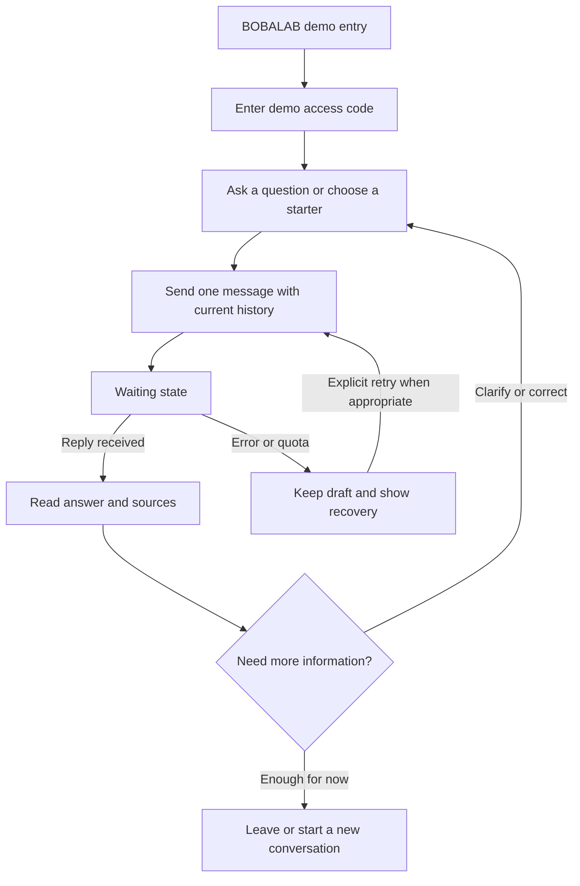

# BOBALAB — self-contained specialist design packet

Prepared 28 October 2026. Website name is fixed: **BOBALAB**. CI means visual brand identity.
Design/proposal materials, not an implemented website. No credentials are included.
The expanded ZIP/repository includes the user-provided UI UX Pro Max skill and license.
The reviewed master below reconciles generic search output with product constraints.
If code execution is unavailable, use these references and do not claim the skill ran.
Give the specialist DESIGNER_PROMPT.md with this packet.

---

<!-- Source: docs/design/DESIGN_HANDOFF.md -->

# BOBALAB — interface and visual identity brief

Status: ready for specialist design; not an implemented UI. Prepared 28 October
2026 from the current code and the candidate's recorded decisions.

## 1. Identity and purpose

**Website name and primary wordmark: BOBALAB.** Preserve this exact name. Do not
invent an alternative brand, unrelated assistant persona or named chatbot.
An explanatory subtitle such as "Visa support demo" is allowed; it is not a new
product name. Browser title proposal: "BOBALAB | Visa support demo".

Build a usable browser entry point to the working Thai DTV support API for this
take-home assessment. Help a person understand their immediate concern, available
information, uncertainty and next step. The interface should make it easy to read
and continue a conversation without suggesting real visa processing is occurring.

This is an assessment demonstration using synthetic enquiries, limited reviewed
sources and sample agency information. It is not an official embassy service or
a confirmed operating immigration agency. Human, approachable writing must not
misrepresent the assistant as a human consultant.

## 2. Decisions and authority

| Status | Decision |
|---|---|
| User-confirmed | Name BOBALAB; CI means visual brand identity |
| User-confirmed | Add a browser interface; prepare requirements for a specialist LLM |
| User-confirmed | Concern-first support; clear sources, practical options and tradeoffs |
| User-confirmed | Describe options, then offer a recommendation conditional on known priorities |
| User-confirmed | Less adamant tone; uncertainty; useful continuation or invitation to correct |
| User-confirmed | Strictly free services; accept limits and slow starts |
| Existing constraint | Automatic learning edits behavior, not facts/model weights; all three APIs remain |
| Proposed | One customer chat screen and About panel; access-code gate; English UI with English/Thai chat support |
| Proposed | Calm warm-neutral/green palette; IBM Plex typography; responsive flat conversation layout |
| Not provided | Official logo files, official brand colours or a BOBALAB brand manual |

The earlier API-only choice is historical; this request expands the scope. The
designer must distinguish proposed visual choices from user-approved decisions.

## 3. Users and immediate needs

Primary user: a person trying a synthetic visa enquiry, often uncertain about
preparation, timing, costs or what the assistant can actually do. They may write
in English or Thai, use a phone, and be unfamiliar with technical language.

Secondary user: an assessor testing the service and reading the evidence. Keep
their documentation/evidence access separate from the customer's conversation.
Do not put system prompts, training controls, raw JSON or internal model metrics
in the customer flow. A read-only documentation link can serve assessors.

## 4. Minimum browser release

### Required customer-facing features

- Responsive chat with readable English/Thai input/output and current-thread context.
- Clear demo access entry, using a future server-side browser session rather than
  exposing the privileged reviewer API key. See the technical appendix.
- Empty state with a short invitation and a few optional starter questions.
- Text composer, explicit Send, multiline support and visible pending state.
- One request at a time, preserving the draft on error and preventing duplicate sends.
- Faithful display of the actual aiReply, including line breaks and uncertainty.
- Safe, clickable source links when the reply contains them. No "verified answer" badge.
- Clear recovery for access expiry, input limits, unavailable service and quotas.
- New conversation/reset with confirmation when it would discard the current thread.
- About panel describing scope, AI/demo status, source limits and data handling.
- Copy reply action with success/failure feedback, if it fits the core layout.

### Outside the minimum release

- Document uploads/inspection, payment checks, bookings or application submissions.
- Live-agent transfer, staff notifications or promised follow-up.
- Accounts, saved conversation lists, cross-device history, analytics or persistent chat storage.
- Voice, live translation, file export, marketing funnels or a full content website.
- Live search, visa eligibility calculators, approval scores or application trackers.
- Public automatic/manual prompt-edit controls or rollback buttons.
- Simulated token streaming: the existing API returns one complete JSON response.

Optional later: a protected reviewer workspace that calls the two improvement
endpoints and shows prediction, actual change, status and versions. It needs a
separate authorization design and is not needed for the customer chat release.

## 5. Customer journey

| Stage | Customer need | UI behavior | Real system boundary |
|---|---|---|---|
| Arrive | Understand what this is | BOBALAB name, short scope/demo note, access entry | No operational agency or embassy identity implied |
| Enter | Try without a long onboarding form | Demo access code; then question or starter | Browser session is proposed, not implemented |
| Ask | Explain the immediate concern | Composer; retain known details in current thread | Client sends history with each request |
| Wait | Know the request is in progress | Honest pending state and slow-service message | No known progress percentage or guaranteed ETA |
| Read | Understand the answer and its limits | Clear text, relevant sources, readable spacing | Model behavior is imperfect; UI must not invent missing content |
| Decide | Compare useful paths | Show actual comparisons and conditional reasoning when present | No fabricated recommendation cards or eligibility conclusion |
| Clarify | Correct a constraint or ask more | Continue in the same thread | Keep exact request/response ordering |
| Act or leave | Know a feasible next step | Preparation/checking guidance as actually given; reset or close | No booking, submission or team contact takes place |



No application-progress bar should be inferred from this journey. It describes
information use, not tracked operational milestones or customer conversion.

## 6. Information hierarchy

| Kind of enquiry | Intended content order |
|---|---|
| Simple definition | Answer, then an essential qualification if needed |
| Practical choice | Main constraint, relevant option tradeoffs, conditional recommendation, useful next step |
| Missing material information | What can be said, what is uncertain, focused clarification |
| Unavailable action | Acknowledge, relevant capability limit, feasible route to verification |

Recommendations should explain the connection to the customer's stated priorities
and leave room for a material correction. Do not repeat known priorities merely to
ask for agreement. A closing question is useful only when it supports continuation.

These are product intentions, not guaranteed structured backend fields. Earlier
hierarchy prompt experiments were rolled back after mixed results. The UI must
not silently rewrite, reorder, strengthen or add to model advice to make it look
as though learning succeeded. Essential uncertainty stays visible, not behind
a collapsed disclosure. New rendering behavior requires separate verification.

## 7. Screen inventory and low-fidelity layouts

### S1 — Demo access

BOBALAB wordmark, "Visa support demo", concise explanation, labeled access-code
field, Show/hide code control and "Open demo" action. Provide a useful invalid-code
message and the route to the code the reviewer was privately given. Do not ask for
Gemini, database or privileged reviewer keys. No new account or identity documents.

### S2 — Empty chat / desktop

```text
┌────────────────────────────────────────────────────────────────────┐
│ BOBALAB   Visa support demo                   About   New chat     │
├────────────────────────────────────────────────────────────────────┤
│ AI demo · Use made-up examples. Don't send personal documents.      │
│                                                                    │
│             What would you like to understand?                     │
│             Ask about preparation, timing or a concern.            │
│                                                                    │
│       [What is the DTV generally for?] [Planning my next step]      │
│                                                                    │
│        ┌───────────────────────────────────────────────────┐       │
│        │ Ask your question…                               │       │
│        │                                            Send  │       │
│        └───────────────────────────────────────────────────┘       │
│            AI can make mistakes. Check relevant sources.           │
└────────────────────────────────────────────────────────────────────┘
```

Starters prefill the composer; they do not spend a model call before Send. Proposed
starters should be neutral enquiries, not promises such as "Check my payment".

### S3 — Active chat / desktop

```text
┌────────────────────────────────────────────────────────────────────┐
│ BOBALAB   Visa support demo                   About   New chat     │
├────────────────────────────────────────────────────────────────────┤
│ Demo notice remains discoverable without dominating every reply.   │
│                                                                    │
│                  Customer question in a restrained tinted bubble   │
│                                                                    │
│ BOBALAB assistant                                                  │
│ Actual answer, readable paragraphs and any options it supplied.     │
│ Important uncertainty remains in the conversation.                 │
│ Sources mentioned: readable title/link when provided                │
│ [Copy reply]                                                       │
│                                                                    │
│        ┌───────────────────────────────────────────────────┐       │
│        │ Follow up or clarify…                            │       │
│        │                                            Send  │       │
│        └───────────────────────────────────────────────────┘       │
└────────────────────────────────────────────────────────────────────┘
```

Use a centered, restrained reading column, approximately 680–760 px on a large
screen, with breathing room. Prefer flat assistant text and subtle user bubbles
over cards inside cards. A sidebar is optional; do not invent saved chat history.

### S4 — Mobile

```text
┌───────────────────────────────┐
│ BOBALAB              About ⋯  │
│ Visa support demo             │
├───────────────────────────────┤
│ Compact demo/privacy note     │
│                               │
│          Customer question    │
│                               │
│ BOBALAB assistant             │
│ Readable answer and caveats   │
│ Sources mentioned            │
│                               │
├───────────────────────────────┤
│ Follow up…                    │
│                         Send  │
└───────────────────────────────┘
```

Composer stays usable with the mobile keyboard and safe area. Avoid narrow split
panes and horizontally scrolling option tables. Confirm reset on a populated
thread. Keep essential uncertainty visible when the keyboard is open.

### S5 — About / source information panel

Explain AI/demo status, limited reviewed sources, no operational integrations and
synthetic-data use. Distinguish model-provider handling from the app's proposed
in-memory chat behavior. A source being an official URL does not verify every
claim or imply endorsement. Offer documentation/evidence links in a secondary area.

### Required variants for S2–S4

Empty; draft; sending; slow response; received; no cited sources; long response;
Thai/mixed-language response; retryable error; access expired; rate limited;
daily allowance exhausted; input/history limit; reset confirmation; narrow viewport.

## 8. Visual brand identity proposal

Brand character: clear, attentive, calm and capable. The interface should make a
complicated question feel manageable. It should look like a support product rather
than a visa advertisement or a technical lab dashboard.

- Name: BOBALAB, consistently capitalized.
- Wordmark proposal: clean typographic BOBALAB; text-only is acceptable initially.
- Any new symbol must remain subordinate to the name. No unrelated mascot/name.
- Do not fabricate an official lab logo or copy government seals, passport stamps,
  approval emblems, national insignia or another service's identity.
- No claims of government affiliation, legal-team availability or success rates.
- Avoid stock travel photos, large promotional heroes and decorative elements that
  displace the conversation. Illustrations are optional, not required assets.

Proposed palette; exact machine-readable values are in design-tokens.json:

| Role | Proposed value | Intended use |
|---|---|---|
| Background | #F7F6F2 | Warm, quiet app canvas |
| Surface | #FFFFFF | Composer/panel backgrounds |
| Main text | #182B29 | Headings and conversation |
| Secondary text | #51645F | Supporting labels, readable metadata |
| Primary | #1D5D4F | Send/action/focus; not a claim of answer verification |
| Gentle tint | #DDECE6 | User message background |
| Decorative border | #D7E1DC | Nonessential separators only |
| Control border | #6B7F76 | Essential input/control boundaries |
| Error text | #A32935 | Errors with text/icon, not colour alone |
| Notice text | #795300 | Caution/uncertainty notices with written explanation |

Selected contrast pairs are computed separately. Any palette revision must be
rechecked; the calculation is not a complete accessibility certification.

## 9. Fonts and typography proposal

Use **IBM Plex Sans** for Latin UI and **IBM Plex Sans Thai Looped** for Thai.
Proposed weights: 400 body, 500 labels, 600 headings/actions. This pairing keeps
the family coherent while allowing Thai text to be checked for legibility.

Official availability: [IBM Plex repository](https://github.com/IBM/plex) and
[IBM typeface reference](https://www.ibm.com/design/language/typography/typeface/).
The upstream [font license](https://github.com/IBM/plex/blob/master/LICENSE.txt)
is Open Font License 1.1. Preserve its license/notices with redistributed font
files. The packet names the fonts; it does not bundle font files or a final logo.

Implementation proposal: self-host only the required WOFF2 faces, use font-display
swap, and keep a system fallback. No paid fonts or mandatory third-party font call.
English stack: IBM Plex Sans, IBM Plex Sans Thai Looped, system-ui, sans-serif.
For Thai-language content, place the Thai Looped family first and test mixed text.

| Element | Proposed size / line height |
|---|---|
| Initial invitation | 28–32 px / 1.2; smaller on mobile |
| App headings | 24 px / 1.3 |
| Conversation | 17 px / 1.6; Thai may need 1.75 after rendering checks |
| Form labels/buttons | 16 px / 1.4 |
| Secondary metadata | 14 px / 1.5 |

Use zero added letter spacing for Thai. Test combining marks, wrapping and real
English/Thai fixtures. No clipping or tiny source captions. Numeric sizes and font
choices are proposals; actual browser and native-language review are still required.

## 10. Style and components

- 4/8 px spacing rhythm; 16 px minimum mobile side padding; generous paragraph spacing.
- Restrained rounded corners: about 8 px controls, 12 px messages/panels.
- Minimal shadows; visible borders where needed; no gradient-heavy dashboard shell.
- Clear text labels, visible keyboard focus and disabled/sending states.
- Primary actions about 44 px high as a product usability target, distinct from
  WCAG's smaller minimum target criterion and its exceptions.
- Motion is functional and short; respect reduced-motion preferences. No simulated
  streaming, fake progress percentages or large theatrical animations.

Required components: app header/wordmark, demo notice, access form, starter chip,
message, source link, composer, Send, pending status, error notice, quota notice,
copy action, reset confirmation and About panel. Show hover/focus/disabled/error
variants wherever applicable. Colour alone must not communicate meaning.

## 11. Copy and voice

Proposed interface copy, not model-test evidence:

| Situation | Copy direction |
|---|---|
| Empty | "What would you like to understand?" |
| Composer | "Ask your question…" / "Follow up or clarify…" |
| Pending | "Preparing a reply…" |
| Slow | "This may take a little longer on free hosting." |
| Retryable failure | "The assistant couldn't reply. Your message is still here." |
| Daily limit | "The demo has reached its daily allowance. Please try another Bangkok day." |
| Source area | "Sources mentioned"; not "Fact-checked answer" |
| Reset | "Start a new conversation? This clears the chat in this tab." |

Keep public copy plain; do not expose prompt-version IDs, exception names or raw
provider errors. Acknowledge limits without listing internal integrations. Make
the AI identity and synthetic nature clear in the interface without labeling
official visa information as fictional agency policy in every reply.

## 12. Accessibility and delivery

Design toward WCAG 2.2 AA; do not claim compliance before implementation testing.
Ordinary text should meet at least 4.5:1 contrast; large text at least 3:1, with
the standard's exceptions. See [W3C contrast guidance](https://www.w3.org/WAI/WCAG22/Understanding/contrast-minimum.html).
Pointer target minimums and exceptions are described in [W3C target guidance](https://www.w3.org/WAI/WCAG22/Understanding/target-size-minimum.html);
our proposed primary controls target 44 px. Status changes should be exposed to
assistive technology without moving focus unnecessarily, per [W3C status guidance](https://www.w3.org/WAI/WCAG22/Understanding/status-messages.html).

Provide keyboard-only flows, labeled controls, readable focus, reduced motion,
zoom/reflow checks and no loss of content on narrow mobile screens. Test the
mobile keyboard, source-link wrapping and Thai combining marks. English interface
copy plus English/Thai chat support is the proposed MVP; full UI translation is
optional and must not be implied by a nonfunctional language switch.

The specialist should return: a visual concept with rationale; desktop/mobile
screens and all key states; CI/style/token sheet; font/asset manifest; component
specifications; customer-journey map; interaction and accessibility notes; and a
clear handoff identifying required backend work. Visual mockups are not evidence
that backend capabilities exist or that answer quality improved.


---

<!-- Source: docs/design/IMPLEMENTATION_CONSTRAINTS.md -->

# BOBALAB — implementation constraints for the designer/builder

This document describes current facts and proposed work separately. It is not
permission to expose secrets or a claim that browser routes already exist.

## 1. Existing service

- Repository: https://github.com/thakritwww-ux/bobalab-support-assistant
- API origin: https://bobalab-support-assistant.onrender.com
- Flask/Python, Gemini SDK, Supabase Postgres, Render Free.
- A terminal client exists at scripts/chat.py. No browser frontend exists yet.
- All non-health requests currently pass through the X-API-Key gate in
  app/__init__.py. Adding a template at GET / or static assets alone will still
  hit that gate unless carefully scoped browser-route handling is implemented.
- The runtime has one Gunicorn worker/four threads, process-local request throttling
  and a durable 100-model-attempt Bangkok-day budget. Retries consume attempts.
- The three existing assessment contracts and their authentication must remain usable.

## 2. Existing API contract

All requests/outputs are JSON. Model routes require the private reviewer key in
X-API-Key. History runs oldest to newest and excludes the current clientSequence.
Map browser user messages to role client and successful assistant messages to role
consultant. Do not send role assistant or duplicate the pending question in history.

| Existing route | Request | Required response |
|---|---|---|
| POST /generate-reply | clientSequence string, chatHistory array | aiReply string |
| POST /improve-ai | Same plus consultantReply string | predictedReply string, updatedPrompt string |
| POST /improve-ai-manually | instructions string | updatedPrompt string |
| GET /health | No key/body | status, service, readiness; liveness only |

Editing responses additionally expose learningStatus (applied/no_change/rejected),
versionId, appliedEdits and rejectedLearnings. A 200 edit is not necessarily a saved
change. There is no public history, rollback, usage, streaming or structured-decision
endpoint. History/rollback currently use the maintenance CLI.

Exact schema snapshots and limits are in api-contract.json, generated from current
Pydantic models. Principal limits: 6,000 characters per message; 100 history entries;
24,000 conversation characters total; 4,000 manual-instruction characters; request
body at most 64 KiB. The UTF-8 serialized byte limit can be reached before the
character limit, especially with Thai. Server validation remains authoritative.

## 3. Actual reply structure

generate-reply returns one aiReply string. Sources are appended as text with a
title, review date and approved URL. It does not return option cards, recommendation
objects, confidence scores, eligibility results or separate source arrays.

For the first release, preserve the actual text and paragraphs. Render as text,
with safe links for approved source URLs. Do not parse arbitrary sentences into
"verified" cards, fabricate a recommended option, omit caveats or invent missing
comparison content. Source URL identity is checked by the backend; relevance can
still be wrong. Use "Sources mentioned" rather than a factual-verification claim.

Rich source/option components would require a separately specified and tested
adapter contract. They must not add another model call or change the required API
response shapes silently. Do not implement them merely because a mockup shows cards.

## 4. Proposed browser integration — not implemented

Recommended minimal path: serve responsive HTML/CSS/JS from the existing Flask app
and add a same-origin, authenticated browser adapter. This avoids requiring another
paid service or separate frontend host. A specialist may propose a different free
stack, but must justify extra hosting, build complexity and authentication work.

Proposed route names, which do not exist yet:

| Route | Intended access and behavior |
|---|---|
| GET / and static assets | Public shell/access UI; no privileged data |
| POST /ui/session | Rate-limited demo-code verification and browser session creation |
| POST /ui/chat | Authenticated browser session; validate context and call the generation service once |
| POST /ui/logout | Clear browser session; protected against cross-site submission |

The shell can show access entry or chat according to session state. Keep the original
three API routes behind X-API-Key. Do not make cookie login an alternative credential
for automatic/manual improvement routes: that would grant chat users prompt-edit power.
Do not remove the key gate globally to make the website load.

New browser access code/session-secret configuration would be required; placeholders
such as UI_DEMO_ACCESS_CODE and UI_SESSION_SECRET are **planned names only**. They
are not configured and no values belong in this packet. A short-lived cookie session
should contain only minimal authorization state, never provider/reviewer keys or
conversation transcripts. Add secure/HttpOnly/SameSite cookie settings, cross-site
request protection, logout and login/usage controls before publishing the adapter.

The server can reuse AssistantService.generate directly after browser authentication,
input validation and request throttling. Preserve the durable model allowance. Do
not proxy arbitrary URLs or accept client-selected credentials. An unprotected proxy
with a hidden key is still an unprotected model-spending endpoint.

No Gemini, database, privileged reviewer or session-signing key belongs in browser
JavaScript, public-prefixed environment variables, localStorage, screenshots or a
specialist-LLM prompt. The demo access code is distinct from those keys. For technical
implementation, consult [Flask security guidance](https://flask.palletsprojects.com/en/stable/web-security/).
This describes required work; this packet does not implement authentication.

## 5. Conversation state and pending requests

- Default to memory in the open tab only. Do not save chats to localStorage,
  sessionStorage, a database or analytics without a separate approved feature.
- Append a user turn and assistant turn to the request history only after a
  successful response. Keep failed/pending message state separate for retry UI.
- Allow one in-flight send per chat. Enter sends, Shift+Enter creates a new line;
  respect composition events so IME input is not submitted prematurely.
- A starter fills the draft and still requires Send. Do not call the model on page
  load, while typing, for source display, or merely to demonstrate loading states.
- Preserve drafts after errors. Avoid silent automatic retries; every attempt may
  consume the shared allowance. Retry is an explicit action.
- Use a client request identity so reset/logout or a stale response cannot insert
  an old answer into a new conversation. Reset is not a server-side generation cancel.
- No token stream exists. Show an indeterminate pending state, then the complete
  response. Do not offer "Stop generating" unless actual cancellation is implemented.
- A refresh/reset clears the local thread, not the provider's records. Do not claim
  provider erasure. Explain that messages are sent to the model provider; its data
  handling is separate from the app's proposed local conversation state.

## 6. Loading and errors

Use the current 150-second client ceiling as a starting implementation constraint,
not an advertised wait time. The observed first resumed health probe was 52.409
seconds without proof of actual Render sleep state. Model requests have also failed.
No fake percentage, known completion time or "legal team is reviewing" animation.

| Situation | Customer recovery |
|---|---|
| Draft/empty | Send disabled for empty input; clear instructions and labels |
| Pending | Disable duplicate send; announce preparing reply without moving focus |
| Slow response | Patient free-hosting message; retain the draft and conversation |
| 400/413 | Explain message/history limit; shorten or start a new conversation |
| Browser session expiry | Preserve the draft in memory, ask to reopen demo access |
| API 401/config issue inside adapter | Owner configuration issue; never ask customer for provider/reviewer keys |
| 429 request_limit | Respect a valid Retry-After delay; no automatic retry loop |
| 429 daily_call_limit | Explain shared daily allowance; next Bangkok day, not a promised 60-second reset |
| 502 invalid/unsupported output | No fabricated fallback; show inability to prepare a reply and explicit retry |
| 503 provider/database unavailable | Preserve draft, explain temporary unavailability; no claim that payment/application failed |
| Network timeout | Explain no reply arrived; do not assert the server stopped processing |

Existing error envelope: {"error":{"code":"…","message":"…"}}. Display safe
customer copy; retain status/code for controlled diagnostics without logging user
content or keys. Health only shows process liveness, not model/database readiness.
There is no usage-count API: do not invent "messages remaining" metrics.

## 7. Safe display and privacy

Treat both model and customer text as untrusted. Use escaped text nodes or a narrowly
sanitized renderer; never raw innerHTML. Permit only approved HTTPS source URLs in
assistant source linkification; label destinations and use safe external-link behavior.
Do not execute links/code embedded in a customer message. Source inspection never
requires exposing system prompts or API credentials to the browser.

No uploads, payment details, identity-document collection or staff notification
controls. No analytics or raw-message logging in the initial release. Demo copy must
not say "nothing is stored anywhere" because the model provider receives messages.

## 8. Verification and release gates

Existing 63 tests are backend evidence; they are not browser tests or evidence of
WCAG compliance. A future implementation must add meaningful checks for session
isolation, protected edit routes, CSRF, escaped model text, safe source links, history
ordering, stale-response/reset handling, retries and duplicate sends. Also test real
desktop/mobile layouts, keyboard flow, Thai text and slow/failure states.

Keep fixtures clearly labeled and distinguish simulated UI tests from real provider
calls. Use the stable evaluated prompt for UI integration. No new training batch,
model swap or source edit is required to design the interface. Compare semantic
answer quality separately from visual polish. Run the three original cURLs again
after integration to ensure existing reviewer access and persistence still work.

No production deployment, new account, paid service, browser-auth configuration or
email sending is part of this materials task. The next builder must implement and
verify the proposed routes before the interface can be called operational.


---

<!-- Source: docs/design/REQUIREMENTS_CHECKLIST.md -->

# BOBALAB interface requirements and acceptance list

P0 means required for the proposed first browser release. P1 is optional afterward.
These requirements are prepared; **implementation checks below have not run**.
CI here means visual identity. No automated CI pipeline is being requested or added.

| ID | Priority | Requirement | Acceptance evidence for the next builder |
|---|---|---|---|
| ID-01 | P0 | Name remains BOBALAB | Name/wordmark/title consistent on all screens; no renamed assistant/product |
| ID-02 | P0 | Truthful identity | AI/demo status visible; no government seal, fake agency identity or human-consultant impersonation |
| ID-03 | P0 | Proposed vs official CI separated | Brand rationale states that official BOBALAB assets were not provided |
| UI-01 | P0 | Responsive conversation layout | Desktop 1440/1280, tablet 768 and mobile 390/360 layouts; no clipped composer/content |
| UI-02 | P0 | Empty state and starters | Clear invitation; starter prefills draft; no unsolicited model request |
| UI-03 | P0 | Message/composer semantics | Labeled textarea, usable Send, multiline/composition handling and empty-input prevention |
| UI-04 | P0 | Current-thread context | Second message receives ordered prior client/consultant history; current question included once |
| UI-05 | P0 | One request at a time | Double-click/Enter cannot produce duplicate generation; stale responses do not enter reset threads |
| UI-06 | P0 | Complete state set | Empty/draft/pending/slow/reply/error/access/quota/limit/reset layouts supplied and implemented |
| UI-07 | P0 | Faithful actual output | Full reply and material caveats retained; no invented option/recommendation/source cards |
| UI-08 | P0 | Sources when present | Approved links clickable and readable; no verification badge or unsupported freshness claim |
| UI-09 | P0 | No fake capabilities | No uploads, payment confirmation, booking, submission, case tracking or team-contact controls |
| UI-10 | P0 | New conversation | Confirm destructive reset; clear local thread/draft; explain limits of deletion |
| UI-11 | P0 | Scope/data handling | About panel accurately explains demo, limited sources, local thread and external provider handling |
| UI-12 | P0 | Usable English/Thai text | Combining marks, mixed text, long URLs and line breaks display without clipping |
| UX-01 | P0 | Customer concern before funnel | No forced nationality/intake form or sales step before a general question |
| UX-02 | P0 | Conditional decision support | UI accommodates option tradeoffs and corrections but does not manufacture missing model content |
| UX-03 | P0 | Honest loading | No token streaming/progress percentage/guaranteed ETA without actual backend support |
| UX-04 | P0 | Recovery preserves work | Draft retained; explicit retry; request/daily quotas distinguished; no paid fallback |
| UX-05 | P0 | Clear source scope | No implication that an official source validates every claim or every application country |
| SEC-01 | P0 | Server-only credentials | No provider, DB, reviewer or signing keys in assets/storage/screenshots/network responses |
| SEC-02 | P0 | Gated browser adapter | Session/demo access implemented and rate limited; no unprotected spending proxy |
| SEC-03 | P0 | Original API auth preserved | Existing three API routes still require X-API-Key; browser chat session cannot edit prompts |
| SEC-04 | P0 | Exact public-route boundaries | Public shell/static/session entry work without disabling authentication globally |
| SEC-05 | P0 | Browser security | Session/logout, secure cookie settings and cross-site submission controls tested |
| SEC-06 | P0 | Safe rendering | Malicious HTML is text; no executable links; approved source URLs only for source treatment |
| DATA-01 | P0 | Request bounds | Message/context and serialized byte limits respected; no silent context truncation |
| DATA-02 | P0 | No transcript persistence by default | No localStorage/sessionStorage/database/analytics chat writes; no raw-body diagnostics |
| A11Y-01 | P0 | Measured contrast | Text pairs checked for intended size; essential boundaries/focus remain perceivable |
| A11Y-02 | P0 | Keyboard/screen reader | Focus order, labels, pending/error announcements and reset dialog tested |
| A11Y-03 | P0 | Reflow and interaction | Zoom/reflow, mobile keyboard, touch targets and reduced-motion preference tested |
| FONT-01 | P0 | License/asset manifest | Actual self-hosted fonts identified with version/weights and upstream license included |
| QA-01 | P0 | Tests remain honest | Backend tests, browser tests, fixture simulations and live calls reported separately |
| QA-02 | P0 | Original contracts retained | Three original cURLs and active DB prompt behavior rechecked after UI integration |
| QA-03 | P0 | Budget and scope | Free services; no provider change/new deployment/account without justified authorization |
| DEL-01 | P0 | Design handoff complete | CI sheet, components, desktop/mobile screens, states, journey and constraints delivered |
| DEL-02 | P0 | Contribution attribution | User choices distinguished from specialist proposals/implementation; no unmeasured benefit claims |
| OPT-01 | P1 | Full UI localization | Real English/Thai interface translations reviewed; no fake language switch |
| OPT-02 | P1 | Read-only evidence view | Clearly labeled before/after examples and provenance; no cherry-picked improvement claim |
| OPT-03 | P1 | Reviewer editing workspace | Separate privileged auth; statuses/version/conflict handling; no customer exposure |

## Design delivery acceptance

- [ ] Specialist produces the BOBALAB visual proposal and explains its choices.
- [ ] All P0 screens/states/components and mobile variants are specified.
- [ ] Proposed branding is identified as a proposal, with no invented official assets.
- [ ] Layout does not assume unsupported backend fields/capabilities.
- [ ] Font source/license, tokens and accessibility checks are handed off.
- [ ] Remaining questions/dependencies are explicit; no fake implemented status.

## Implementation release acceptance — a later stage

- [ ] Browser adapter/session/access configuration implemented and tested.
- [ ] Chat, context, errors, sources and reset verified with fixtures and real calls.
- [ ] Security and accessibility checks above completed, with observed results.
- [ ] Three existing API contracts and database edit behavior still work.
- [ ] README, hosted URL, contribution notes and AI log reflect actual UI work.

Prepared materials do not satisfy these implementation boxes. No web application
has been built as part of this handoff task.


---

<!-- Source: docs/design/UI_UX_PRO_MAX_USAGE.md -->

# Using UI UX Pro Max for BOBALAB

The candidate supplied `.codex/skills/ui-ux-pro-max/` and authorized publishing and
using it. This is a local Python/CSV design-guidance skill, not another LLM, model
API or deployment service. Python 3.12 in the existing project environment works;
its search scripts use the standard library and need no provider key.

## Call it from the repository root

```sh
.venv/bin/python -B .codex/skills/ui-ux-pro-max/scripts/search.py \
  "customer support chatbot conversational interface minimal calm accessible multilingual Thai English" \
  --design-system -p BOBALAB -f markdown
```

Use the project's setup instructions to create .venv in a fresh checkout. An
environment with a suitable Python installation can use that interpreter directly.
The script/data folder structure must remain intact. Menu auto-discovery in other
assistants has not been verified; direct script invocation has.

Generate raw references into a separate folder so they cannot overwrite the
reviewed proposal:

```sh
.venv/bin/python -B .codex/skills/ui-ux-pro-max/scripts/search.py \
  "customer support chatbot conversational interface minimal calm accessible multilingual Thai English" \
  --design-system --persist -p BOBALAB -f markdown \
  --output-dir work/ui-ux-pro-max-generated --page chat
```

That creates work/ui-ux-pro-max-generated/design-system/bobalab/MASTER.md and
pages/chat.md. The reviewed starting proposal lives separately at
[design-system/bobalab/MASTER.md](https://github.com/thakritwww-ux/bobalab-support-assistant/blob/main/design-system/bobalab/MASTER.md).

Useful follow-up searches:

```sh
.venv/bin/python -B .codex/skills/ui-ux-pro-max/scripts/search.py \
  "chat focus scroll status messages keyboard" --domain web --json
.venv/bin/python -B .codex/skills/ui-ux-pro-max/scripts/search.py \
  "loading error recovery feedback" --domain ux --json
.venv/bin/python -B .codex/skills/ui-ux-pro-max/scripts/search.py \
  "responsive form keyboard focus" --stack html-tailwind --json
```

The stack search is reference guidance, not a mandate to replace the Flask service
or introduce a new frontend host. Product/user requirements override generic skill
recommendations. See [third-party notices](https://github.com/thakritwww-ux/bobalab-support-assistant/blob/main/THIRD_PARTY_NOTICES.md) and
[the supplied-file manifest](https://github.com/thakritwww-ux/bobalab-support-assistant/blob/main/docs/design/ui-ux-pro-max-provenance.json).

## What the generated output changed or did not change

| Tool recommendation | Review decision |
|---|---|
| Minimal-chrome conversational UI | Use as a direction for the chat screen; no full dashboard |
| Keyboard support, visible focus, inline errors and recovery | Retain; prefer native controls over the example clickable div |
| Async loading feedback | Retain an honest pending state; no fake stream/progress |
| FAQ/search landing, analytics, contact escalation | Do not adopt; outside the requested chat and unavailable backend capabilities |
| Purple/cyan palette | Keep as an unreviewed alternative; current warm-neutral/green proposal remains |
| Noto Sans Thai | Record as an alternative; no font switch or unverified licensing claim |
| Streaming/pulse/context-card effects | Do not copy as real capabilities; no stream or structured-card API exists |
| Accessibility/performance checkmarks | Do not treat as measured compliance or performance evidence |

The raw button suggestion uses white text on cyan #06B6D4. Its measured contrast is
recorded in ui-ux-pro-max-review.json and does not meet our normal-size action-text
target. The retained palette's previously computed checks remain separate from a
future rendered UI/accessibility audit.

The reviewed master/page files are assistant-authored reconciliations of generated
guidance and the existing handoff. They are not a final user-approved visual system
or a working website. The specialist can propose changes while preserving the
BOBALAB name, API/security constraints and honest capability boundaries.


---

<!-- Source: design-system/bobalab/MASTER.md -->

# BOBALAB design system — reviewed starting proposal

Prepared 28 October 2026. **Not an approved official BOBALAB CI or an implemented
website.** This master reconciles UI UX Pro Max output with the existing handoff.

## Authority and use

1. The user's BOBALAB name, scope, budget and product decisions are fixed constraints.
2. Actual backend behavior and [implementation constraints](https://github.com/thakritwww-ux/bobalab-support-assistant/blob/main/docs/design/IMPLEMENTATION_CONSTRAINTS.md)
   determine which interactions are real.
3. This reviewed master and [design tokens](https://github.com/thakritwww-ux/bobalab-support-assistant/blob/main/docs/design/design-tokens.json)
   are the current visual starting proposal.
4. Page files may refine local layout/interaction details. They cannot override
   naming, capabilities, source honesty, privacy or authentication requirements.

The specialist may propose visual refinements with a reason. Do not automatically
replace this file with generic search output. Record what was changed and why.

## Identity

Use **BOBALAB**, with an explanatory "Visa support demo" subtitle if useful.
Use a typographic wordmark initially. No unrelated product/bot name, fabricated
official logo, embassy seal, government affiliation or approval emblem.

## Experience and layout

Use a responsive conversational interface with minimal chrome: demo access entry,
one chat screen, an About panel and honest failure/recovery states. A central
680–760 px reading column and restrained user bubbles keep the answer easy to read.
No marketing hero, FAQ-first landing funnel, pricing section or analytics dashboard.

Show the actual answer faithfully. Accommodate conditional options and a helpful
continuation when present, without constructing missing advice or hiding caveats.
Keep sources labeled "Sources mentioned". Do not treat a trusted URL as an answer
verification badge. No operational case-progress indicator.

## Palette and fonts

Retain the existing proposed palette while specialist review is pending:

| Role | Value |
|---|---|
| Canvas / surface | #F7F6F2 / #FFFFFF |
| Main / secondary text | #182B29 / #51645F |
| Primary / primary text | #1D5D4F / #FFFFFF |
| User tint | #DDECE6 |
| Essential control border | #6B7F76 |
| Decorative separator | #D7E1DC |
| Error / notice text | #A32935 / #795300 |

IBM Plex Sans for Latin and IBM Plex Sans Thai Looped for Thai remain proposed.
Use weights 400/500/600, 17 px conversation text, comfortable line height and
14 px readable metadata. Font files are not bundled yet; follow the
[font manifest](https://github.com/thakritwww-ux/bobalab-support-assistant/blob/main/docs/design/font-manifest.json) and retain upstream notices.

Do not silently adopt the tool's purple/cyan palette or Noto alternative. Those are
unreviewed alternatives, not the user's choices. Recheck actual state contrasts
after any visual revision. The tool's accessibility labels are not compliance tests.

## Components and interactions

- Native buttons, links and labeled inputs; avoid copying generic clickable-div examples.
- Clear keyboard focus and error text associated with the affected field.
- One pending request, disabled duplicate Send and a preserved draft on failure.
- Honest indeterminate loading; no simulated streaming or made-up completion time.
- Concise recovery action appropriate to rate, daily allowance, access or provider error.
- Reset confirmation on an existing conversation; reject stale replies after reset.
- No forced scroll to the bottom while a person is reading earlier text. Offer a
  nonintrusive jump to a newly arrived reply when appropriate.
- Functional short transitions and reduced-motion support; no distracting pulses.
- Consistent SVG icons with labels where needed; no emoji interface icons.

## Hard boundaries

No file inspection, payment confirmation, booking, application submission, legal-team
notification, saved chat list or real-time escalation. No model calls while typing
or on page load. No paid fallback. No provider, DB or reviewer key in the browser.
The proposed browser session adapter does not exist yet; implement and test it
before publishing a functioning UI. Preserve all three current API contracts.

## Pages and verification

- [Chat page](https://github.com/thakritwww-ux/bobalab-support-assistant/blob/main/design-system/bobalab/pages/chat.md)
- [Access entry](https://github.com/thakritwww-ux/bobalab-support-assistant/blob/main/design-system/bobalab/pages/access.md)
- [Full requirement checklist](https://github.com/thakritwww-ux/bobalab-support-assistant/blob/main/docs/design/REQUIREMENTS_CHECKLIST.md)
- [Tool use and review rationale](https://github.com/thakritwww-ux/bobalab-support-assistant/blob/main/docs/design/UI_UX_PRO_MAX_USAGE.md)

No UI test, native-language review or full accessibility audit has been completed
by writing this master. Existing backend tests remain a separate evidence set.


---

<!-- Source: design-system/bobalab/pages/chat.md -->

# BOBALAB — chat page refinements

Status: design proposal; use with ../MASTER.md and the confirmed product constraints.

- Header: BOBALAB, concise demo subtitle, About and New chat. No saved-history rail.
- Empty state: a short invitation and optional starters that fill the composer.
- Active state: restrained user bubble, flat assistant text, relevant source links
  when provided, and a persistent usable composer.
- Keep the real reply intact. Do not split it into fictional decision/source fields.
- Use an inline pending indicator and a slow-service explanation, not fake word streaming.
- Put errors near the composer/failed message and pair them with a recovery action.
  Do not repeatedly steal focus when a background status changes.
- Keep draft/history state separate from an unresolved request. Retry is explicit;
  do not duplicate a pending message or insert stale responses after reset.
- Test 360/390 px mobile, 768 px tablet and 1280/1440 px desktop, including the
  mobile keyboard, Thai combining marks, long replies and long source URLs.
- When the reader has scrolled upward, do not yank their reading position to a new
  reply. A "New reply" jump control can appear only after a reply actually arrives.
- Recommended body 17 px, spacious line height, no tiny citation captions and no
  horizontal option tables on narrow screens.

All palette/font values remain in the reviewed master/tokens. These refinements
cannot grant new backend capabilities or expose prompt-editing controls to chat users.


---

<!-- Source: design-system/bobalab/pages/access.md -->

# BOBALAB — demo access entry refinements

Status: design proposal; browser authentication is not implemented.

- Use the BOBALAB wordmark and "Visa support demo" subtitle, a short scope note,
  a labeled demo-code input, Show/hide control and "Open demo" action.
- The demo code must be separate from provider, database and privileged reviewer
  credentials. Never ask the user to paste those into the browser.
- Use native form controls; show an associated inline error when a code is rejected.
- Access-expiry recovery should preserve the unsent draft in memory while the tab
  stays open. Do not promise saved conversations or cross-device continuation.
- Keep the form compact and mobile friendly; no intake questionnaire, identity
  upload, account creation, sales funnel or fake official-agency branding.
- The future backend must rate-limit access attempts, create a suitable session,
  enforce generation-only permissions and preserve existing API-key protection.

This page file only refines presentation. It is not a configured access code,
implemented route or permission to bypass the API authentication gate.


---

<!-- Source: docs/design/ui-ux-pro-max-raw-recommendations.md -->

# UI UX Pro Max raw reference — not the adopted design system

This is local search/generation output retained for provenance. Its automatic
performance/accessibility labels are not measured evidence. Its landing structure,
streaming suggestions, palette and typography have not been adopted. Read
UI_UX_PRO_MAX_USAGE.md and the reviewed master before using it.

Query: customer support chatbot conversational interface minimal calm accessible multilingual Thai English

---

## Design System: BOBALAB

### Pattern
- **Name:** FAQ/Documentation Landing
- **Conversion Focus:** Reduce support tickets. Track search analytics. Show related articles. Contact escalation path.
- **CTA Placement:** Search bar prominent + Contact CTA for unresolved questions
- **Color Strategy:** Clean, high readability. Minimal color. Category icons in brand color. Success green for resolved.
- **Sections:** 1. Hero with search bar, 2. Popular categories, 3. FAQ accordion, 4. Contact/support CTA

### Style
- **Name:** AI-Native UI
- **Keywords:** Chatbot, conversational, voice, assistant, agentic, ambient, minimal chrome, streaming text, AI interactions
- **Best For:** AI products, chatbots, voice assistants, copilots, AI-powered tools, conversational interfaces
- **Performance:** ⚡ Excellent | **Accessibility:** ✓ WCAG AA

### Colors
| Role | Hex |
|------|-----|
| Primary | #7C3AED |
| Secondary | #A78BFA |
| CTA | #06B6D4 |
| Background | #FAF5FF |
| Text | #1E1B4B |

*Notes: AI purple + cyan interactions*

### Typography
- **Heading:** Noto Sans Thai
- **Body:** Noto Sans Thai
- **Mood:** thai, modern, readable, clean, multilingual, accessible
- **Best For:** Thai sites, Southeast Asia, tourism, Thai restaurants
- **Google Fonts:** https://fonts.google.com/share?selection.family=Noto+Sans+Thai:wght@300;400;500;700
- **CSS Import:**
```css
@import url('https://fonts.googleapis.com/css2?family=Noto+Sans+Thai:wght@300;400;500;700&display=swap');
```

### Key Effects
Typing indicators (3-dot pulse), streaming text animations, pulse animations, context cards, smooth reveals

### Avoid (Anti-patterns)
- Heavy chrome
- Slow response feedback

### Pre-Delivery Checklist
- [ ] No emojis as icons (use SVG: Heroicons/Lucide)
- [ ] cursor-pointer on all clickable elements
- [ ] Hover states with smooth transitions (150-300ms)
- [ ] Light mode: text contrast 4.5:1 minimum
- [ ] Focus states visible for keyboard nav
- [ ] prefers-reduced-motion respected
- [ ] Responsive: 375px, 768px, 1024px, 1440px


---

<!-- Source: THIRD_PARTY_NOTICES.md -->

# Third-party notices

## UI UX Pro Max

- Local component: `.codex/skills/ui-ux-pro-max/`
- Upstream project: https://github.com/nextlevelbuilder/ui-ux-pro-max-skill
- Copyright: 2024 Next Level Builder
- License: MIT; complete notice is in
  [third_party/ui-ux-pro-max.LICENSE](https://github.com/thakritwww-ux/bobalab-support-assistant/blob/main/third_party/ui-ux-pro-max.LICENSE).

The candidate supplied this local copy. Its scripts, CSV data and SKILL.md are
preserved without an upgrade or source edits. The exact upstream release of those
uploaded files has not been independently identified. A file-hash manifest is in
[ui-ux-pro-max-provenance.json](https://github.com/thakritwww-ux/bobalab-support-assistant/blob/main/docs/design/ui-ux-pro-max-provenance.json).

This notice applies to the vendored skill, not a claim that the whole BOBALAB
application was authored by its upstream contributors. Recommendations are design
guidance and require review against the actual product and accessibility tests.


---

## Appendix — design-tokens.json

```json
{
  "project": "BOBALAB",
  "status": "assistant-proposed starting point, not user-approved final CI",
  "prepared_on": "2026-10-28",
  "official_brand_assets_provided": false,
  "colors": {
    "background": "#F7F6F2",
    "surface": "#FFFFFF",
    "text": "#182B29",
    "textSecondary": "#51645F",
    "primary": "#1D5D4F",
    "primaryHover": "#16483D",
    "onPrimary": "#FFFFFF",
    "userTint": "#DDECE6",
    "borderDecorative": "#D7E1DC",
    "borderControl": "#6B7F76",
    "focus": "#1D5D4F",
    "error": "#A32935",
    "errorSurface": "#FCEEF0",
    "warning": "#795300",
    "warningSurface": "#FFF4D8",
    "info": "#254F78",
    "infoSurface": "#ECF3FA"
  },
  "typography": {
    "latinFamily": "IBM Plex Sans",
    "thaiFamily": "IBM Plex Sans Thai Looped",
    "fallback": [
      "system-ui",
      "sans-serif"
    ],
    "weights": [
      400,
      500,
      600
    ],
    "bodyPx": 17,
    "bodyLineHeight": 1.6,
    "thaiBodyLineHeight": 1.75,
    "metadataPx": 14,
    "headingPx": 24,
    "invitationPx": 32,
    "thaiAddedLetterSpacing": 0,
    "fontDisplay": "swap"
  },
  "spacingPx": [
    4,
    8,
    12,
    16,
    24,
    32,
    48,
    64
  ],
  "radiusPx": {
    "control": 8,
    "message": 12,
    "panel": 12
  },
  "layout": {
    "readingColumnMaxPx": 760,
    "mobileMinSidePaddingPx": 16,
    "designViewportsPx": [
      360,
      390,
      768,
      1280,
      1440
    ],
    "primaryControlHeightTargetPx": 44
  },
  "motion": {
    "shortTransitionMs": 160,
    "respectReducedMotion": true,
    "simulateTokenStreaming": false
  },
  "notes": [
    "Decorative border is not suitable as the only essential control boundary.",
    "Do not use green to claim a model answer is verified.",
    "Numbers are design proposals; test actual rendered states."
  ]
}
```

---

## Appendix — font-manifest.json

```json
{
  "status": "proposed; names/license checked upstream, font files not downloaded or bundled",
  "families": [
    {
      "name": "IBM Plex Sans",
      "use": "Latin interface and messages",
      "weights": [
        400,
        500,
        600
      ]
    },
    {
      "name": "IBM Plex Sans Thai Looped",
      "use": "Thai messages and future Thai interface copy",
      "weights": [
        400,
        500,
        600
      ]
    }
  ],
  "source": "https://github.com/IBM/plex",
  "typeface_reference": "https://www.ibm.com/design/language/typography/typeface/",
  "license": "OFL-1.1",
  "license_url": "https://github.com/IBM/plex/blob/master/LICENSE.txt",
  "implementation_requirements": [
    "Use actual upstream WOFF2 faces and record the chosen version/files.",
    "Retain license and copyright notices with redistributed font assets.",
    "Self-host required normal faces only; no paid font dependency.",
    "Use font-display swap and system fallbacks.",
    "Test English/Thai mixed text, combining marks and wrapping in actual browsers."
  ],
  "approved_final_brand": false
}
```

---

## Appendix — api-contract.json

```json
{
  "snapshot_on": "2026-10-28",
  "origin": "https://bobalab-support-assistant.onrender.com",
  "auth": {
    "existing_model_routes": "X-API-Key: private reviewer key",
    "public_existing_route": "GET /health",
    "browser_session_adapter": "proposed, not implemented",
    "expose_privileged_key_to_browser": false
  },
  "requests": {
    "generate-reply": {
      "$defs": {
        "Turn": {
          "additionalProperties": false,
          "properties": {
            "role": {
              "enum": [
                "client",
                "consultant"
              ],
              "title": "Role",
              "type": "string"
            },
            "message": {
              "maxLength": 6000,
              "minLength": 1,
              "title": "Message",
              "type": "string"
            }
          },
          "required": [
            "role",
            "message"
          ],
          "title": "Turn",
          "type": "object"
        }
      },
      "additionalProperties": false,
      "properties": {
        "clientSequence": {
          "maxLength": 6000,
          "minLength": 1,
          "title": "Clientsequence",
          "type": "string"
        },
        "chatHistory": {
          "items": {
            "$ref": "#/$defs/Turn"
          },
          "maxItems": 100,
          "title": "Chathistory",
          "type": "array"
        }
      },
      "required": [
        "clientSequence"
      ],
      "title": "ReplyRequest",
      "type": "object"
    },
    "improve-ai": {
      "$defs": {
        "Turn": {
          "additionalProperties": false,
          "properties": {
            "role": {
              "enum": [
                "client",
                "consultant"
              ],
              "title": "Role",
              "type": "string"
            },
            "message": {
              "maxLength": 6000,
              "minLength": 1,
              "title": "Message",
              "type": "string"
            }
          },
          "required": [
            "role",
            "message"
          ],
          "title": "Turn",
          "type": "object"
        }
      },
      "additionalProperties": false,
      "properties": {
        "clientSequence": {
          "maxLength": 6000,
          "minLength": 1,
          "title": "Clientsequence",
          "type": "string"
        },
        "chatHistory": {
          "items": {
            "$ref": "#/$defs/Turn"
          },
          "maxItems": 100,
          "title": "Chathistory",
          "type": "array"
        },
        "consultantReply": {
          "maxLength": 6000,
          "minLength": 1,
          "title": "Consultantreply",
          "type": "string"
        }
      },
      "required": [
        "clientSequence",
        "consultantReply"
      ],
      "title": "ImproveRequest",
      "type": "object"
    },
    "improve-ai-manually": {
      "additionalProperties": false,
      "properties": {
        "instructions": {
          "maxLength": 4000,
          "minLength": 1,
          "title": "Instructions",
          "type": "string"
        }
      },
      "required": [
        "instructions"
      ],
      "title": "ManualRequest",
      "type": "object"
    }
  },
  "responses": {
    "generate-reply": {
      "required": [
        "aiReply"
      ],
      "properties": {
        "aiReply": {
          "type": "string"
        }
      },
      "structured_sources_or_options": false,
      "streaming": false
    },
    "improve-ai": {
      "required": [
        "predictedReply",
        "updatedPrompt"
      ],
      "additional_observed": [
        "learningStatus",
        "versionId",
        "appliedEdits",
        "rejectedLearnings"
      ]
    },
    "improve-ai-manually": {
      "required": [
        "updatedPrompt"
      ],
      "additional_observed": [
        "learningStatus",
        "versionId",
        "appliedEdits",
        "rejectedLearnings"
      ]
    },
    "error": {
      "error": {
        "code": "string",
        "message": "string"
      }
    }
  },
  "limits": {
    "requestBytes": 65536,
    "messageCharacters": 6000,
    "historyEntries": 100,
    "conversationCharacters": 24000,
    "manualInstructionCharacters": 4000,
    "defaultModelAttemptsPerBangkokDay": 100,
    "defaultRequestsPerMinutePerProcess": 10,
    "clientTimeoutSecondsSuggested": 150
  },
  "notes": [
    "History roles are client and consultant, oldest to newest; current clientSequence is separate.",
    "chatHistory defaults to an empty array in the current schema; the browser should send it explicitly.",
    "Provider retries consume attempted-model-call allowance; this is not a customer-message counter.",
    "A 200 edit may be applied, no_change or rejected.",
    "GET /health is liveness only, not dependency readiness."
  ]
}
```

---

## Appendix — fixtures.json

```json
{
  "purpose": "Design and future simulated browser tests; no new model calls made for this packet",
  "all_customer_examples_synthetic": true,
  "observed_outputs_are_not_verified_advice": true,
  "fixtures": [
    {
      "id": "empty",
      "kind": "illustrative_interface_copy_not_implemented",
      "state": "empty",
      "heading": "What would you like to understand?",
      "placeholder": "Ask your question…"
    },
    {
      "id": "waiting",
      "kind": "illustrative_interface_copy_not_implemented",
      "state": "pending",
      "text": "Preparing a reply…",
      "fake_progress_or_streaming": false
    },
    {
      "id": "slow",
      "kind": "illustrative_interface_copy_not_implemented",
      "state": "slow",
      "text": "This may take a little longer on free hosting."
    },
    {
      "id": "received-with-sources",
      "kind": "observed_model_output_unreviewed_for_design",
      "state": "received",
      "source_file": "../evidence/submission-regressions.json",
      "source_case": "known-context",
      "request": {
        "clientSequence": "What should I prepare first?",
        "chatHistory": [
          {
            "role": "client",
            "message": "I'm American, working remotely for an overseas employer, and considering applying in Indonesia."
          }
        ]
      },
      "response": {
        "aiReply": "For an application intended through Indonesia, please note that we currently do not have specific reviewed knowledge or guidelines for that mission. General preparation for the Destination Thailand Visa typically involves your passport, a photograph, current-location evidence, financial evidence of at least 500,000 THB, and purpose-of-visit evidence, but you must check the selected mission's current requirements directly. As a demo agency note, our workflow involves document preparation and review before any application submission. A practical next step is to review the specific guidelines published by the official Thai embassy or consulate where you plan to apply.\n\nThai Ministry of Foreign Affairs: DTV overview (July 2024, page 4) (reviewed 2026-10-27): https://image.mfa.go.th/mfa/0/91fPdh6NtO/VISA_Information/New_Visa_Measures_July_2024.pdf"
      },
      "assistant_observation": "Uses the known Indonesia context without repeating nationality/location questions; explains missing mission-specific coverage. Still adds demo workflow background.",
      "approved_customer_copy": false
    },
    {
      "id": "received-thai",
      "kind": "observed_model_output_unreviewed_for_design",
      "state": "received",
      "source_file": "../evidence/submission-regressions.json",
      "source_case": "thai-language",
      "request": {
        "clientSequence": "กำลังคิดจะยื่นวีซ่า DTV ที่กัวลาลัมเปอร์ ควรวางแผนเวลายังไงดี และข้อมูลมาจากไหน",
        "chatHistory": []
      },
      "response": {
        "aiReply": "สำหรับการยื่นวีซ่า DTV ที่สถานเอกอัครราชทูต ณ กรุงกัวลาลัมเปอร์ ทางการแนะนำให้ยื่นล่วงหน้าอย่างน้อย 30 วันทำการก่อนการเดินทาง โดยกระบวนการพิจารณาอาจใช้เวลาประมาณหนึ่งเดือนหรือมากกว่านั้น ขึ้นอยู่กับการพิจารณาเป็นรายกรณี ซึ่งกรอบเวลานี้เป็นเพียงการประมาณการเท่านั้น ข้อมูลดังกล่าวอ้างอิงจากประกาศของสถานเอกอัครราชทูต ณ กรุงกัวลาลัมเปอร์ และข้อมูลภาพรวมจากกระทรวงการต่างประเทศ\n\nRoyal Thai Embassy Kuala Lumpur: DTV guidance (reviewed 2026-10-27): https://kualalumpur.thaiembassy.org/en/publicservice/destination-thailand-visa-dtv\nThai Ministry of Foreign Affairs: DTV overview (July 2024, page 4) (reviewed 2026-10-27): https://image.mfa.go.th/mfa/0/91fPdh6NtO/VISA_Information/New_Visa_Measures_July_2024.pdf"
      },
      "assistant_observation": "Answers primarily in Thai with scoped timing and uncertainty. General overview citation is not needed for the mission-specific estimate.",
      "approved_customer_copy": false
    },
    {
      "id": "received-no-sources",
      "kind": "observed_model_output_unreviewed_for_design",
      "state": "received",
      "source_file": "../evidence/submission-regressions.json",
      "source_case": "payment-not-verified",
      "request": {
        "clientSequence": "I've sent the transfer. Can you confirm you received it?",
        "chatHistory": []
      },
      "response": {
        "aiReply": "I cannot check accounts, locate payments, or confirm whether a transfer has been received in this demo chat. Please check with your bank or prepare your transfer confirmation for the agency's approved channel."
      },
      "assistant_observation": "Does not confirm receipt or claim staff contact. Tone remains impersonal; bank status alone cannot establish agency receipt.",
      "approved_customer_copy": false
    },
    {
      "id": "hypothetical-options",
      "kind": "observed_model_output_with_candidate_preference_and_requested_changes",
      "state": "received",
      "source_file": "../HIERARCHY_COMPARISON.md",
      "request": {
        "clientSequence": "For a hypothetical planning example only, assume booking A costs less but cannot be changed, and booking B costs more but allows date changes. These are assumptions, not real offers or visa rules. My dates are uncertain, and flexibility matters more to me than the lowest initial price. Explain both options and which fits my priorities.",
        "chatHistory": []
      },
      "response": {
        "aiReply": "Booking A has the benefit of a lower initial price, but its main drawback is that it cannot be changed. Booking B has the benefit of allowing date changes when your plans are uncertain, but its main drawback is that it costs more. Based on your stated priority that flexibility matters more to you than the lowest initial price, Booking B fits your priorities better because it accommodates uncertain dates, though you will pay more for that flexibility."
      },
      "limitations": [
        "Hypothetical booking assumptions, not real offers.",
        "Candidate preferred this after output but requested less adamant tone, uncertainty and useful continuation.",
        "Do not treat one preference as endorsement of every factual inference or of the whole playbook."
      ]
    },
    {
      "id": "existing-error-400",
      "kind": "observed_existing_api_error",
      "http_status": 400,
      "response": {
        "error": {
          "code": "invalid_request",
          "message": "Invalid request fields or input limits exceeded. See the documented schema."
        }
      },
      "note": "API 401 is reviewer-key auth; browser-session expiry is a separate proposed adapter state."
    },
    {
      "id": "existing-error-401",
      "kind": "observed_existing_api_error",
      "http_status": 401,
      "response": {
        "error": {
          "code": "unauthorized",
          "message": "Provide the reviewer key in X-API-Key."
        }
      },
      "note": "API 401 is reviewer-key auth; browser-session expiry is a separate proposed adapter state."
    },
    {
      "id": "request-limit",
      "kind": "illustrative_documented_error_shape_not_a_live_capture",
      "http_status": 429,
      "response": {
        "error": {
          "code": "request_limit",
          "message": "Too many requests. Please wait a minute."
        }
      },
      "recovery": "Explicit retry after an appropriate delay."
    },
    {
      "id": "daily-limit",
      "kind": "illustrative_documented_error_shape_not_a_live_capture",
      "http_status": 429,
      "response": {
        "error": {
          "code": "daily_call_limit",
          "message": "The application's daily model-call budget is exhausted. Try the next Bangkok day."
        }
      },
      "recovery": "Do not show a short retry countdown as a daily reset."
    },
    {
      "id": "provider-unavailable",
      "kind": "illustrative_documented_error_shape_not_a_live_capture",
      "http_status": 503,
      "response": {
        "error": {
          "code": "model_unavailable",
          "message": "The model is unavailable or its quota was reached. Try again later."
        }
      }
    },
    {
      "id": "browser-access-expired",
      "kind": "proposed_browser_adapter_state_not_an_existing_endpoint",
      "state": "access_expired",
      "text": "Your demo access has expired. Open the demo again to continue.",
      "preserve_draft_in_memory": true
    },
    {
      "id": "reset",
      "kind": "illustrative_interface_copy_not_implemented",
      "state": "reset_confirmation",
      "text": "Start a new conversation? This clears the chat in this tab."
    }
  ]
}
```

---

## Appendix — contrast-checks.json

```json
{
  "status": "computed selected token pairs only; not rendered UI or complete accessibility audit",
  "method": "sRGB relative luminance contrast ratio",
  "checks": [
    {
      "foreground": "text",
      "background": "background",
      "ratio": 13.71,
      "proposed_minimum": 4.5,
      "meets_selected_numeric_check": true
    },
    {
      "foreground": "text",
      "background": "surface",
      "ratio": 14.83,
      "proposed_minimum": 4.5,
      "meets_selected_numeric_check": true
    },
    {
      "foreground": "textSecondary",
      "background": "background",
      "ratio": 5.82,
      "proposed_minimum": 4.5,
      "meets_selected_numeric_check": true
    },
    {
      "foreground": "textSecondary",
      "background": "surface",
      "ratio": 6.29,
      "proposed_minimum": 4.5,
      "meets_selected_numeric_check": true
    },
    {
      "foreground": "onPrimary",
      "background": "primary",
      "ratio": 7.69,
      "proposed_minimum": 4.5,
      "meets_selected_numeric_check": true
    },
    {
      "foreground": "onPrimary",
      "background": "primaryHover",
      "ratio": 10.35,
      "proposed_minimum": 4.5,
      "meets_selected_numeric_check": true
    },
    {
      "foreground": "text",
      "background": "userTint",
      "ratio": 12.15,
      "proposed_minimum": 4.5,
      "meets_selected_numeric_check": true
    },
    {
      "foreground": "error",
      "background": "errorSurface",
      "ratio": 6.37,
      "proposed_minimum": 4.5,
      "meets_selected_numeric_check": true
    },
    {
      "foreground": "warning",
      "background": "warningSurface",
      "ratio": 6.29,
      "proposed_minimum": 4.5,
      "meets_selected_numeric_check": true
    },
    {
      "foreground": "info",
      "background": "infoSurface",
      "ratio": 7.6,
      "proposed_minimum": 4.5,
      "meets_selected_numeric_check": true
    },
    {
      "foreground": "borderControl",
      "background": "surface",
      "ratio": 4.27,
      "proposed_minimum": 3,
      "meets_selected_numeric_check": true
    },
    {
      "foreground": "focus",
      "background": "background",
      "ratio": 7.11,
      "proposed_minimum": 3,
      "meets_selected_numeric_check": true
    }
  ],
  "recheck_after_palette_or_state_changes": true
}
```

---

## Appendix — ui-ux-pro-max-review.json

```json
{
  "status": "assistant-reviewed starting proposal; not approved official BOBALAB CI or rendered compliance",
  "project": "BOBALAB",
  "runtime_model_calls": 0,
  "query": "customer support chatbot conversational interface minimal calm accessible multilingual Thai English",
  "persist_test": "completed to work/ui-ux-pro-max-generated/design-system/bobalab/MASTER.md and pages/chat.md",
  "reviewed_master": "../../design-system/bobalab/MASTER.md",
  "raw_reference": "ui-ux-pro-max-raw-recommendations.md",
  "ux_results": {
    "domain": "ux",
    "query": "loading error recovery feedback",
    "file": "ux-guidelines.csv",
    "count": 3,
    "results": [
      {
        "Category": "Feedback",
        "Issue": "Error Recovery",
        "Platform": "All",
        "Description": "Help users recover from errors",
        "Do": "Provide clear next steps",
        "Don't": "Error without recovery path",
        "Code Example Good": "Try again button + help link",
        "Code Example Bad": "Error message only",
        "Severity": "Medium"
      },
      {
        "Category": "Interaction",
        "Issue": "Error Feedback",
        "Platform": "All",
        "Description": "Users need to know when something fails",
        "Do": "Show clear error messages near problem",
        "Don't": "Silent failures with no feedback",
        "Code Example Good": "Red border + error message",
        "Code Example Bad": "No indication of error",
        "Severity": "High"
      },
      {
        "Category": "Animation",
        "Issue": "Loading States",
        "Platform": "All",
        "Description": "Show feedback during async operations",
        "Do": "Use skeleton screens or spinners",
        "Don't": "Leave UI frozen with no feedback",
        "Code Example Good": "animate-pulse skeleton",
        "Code Example Bad": "Blank screen while loading",
        "Severity": "High"
      }
    ]
  },
  "web_results": {
    "domain": "web",
    "query": "chat focus scroll status messages keyboard",
    "file": "web-interface.csv",
    "count": 3,
    "results": [
      {
        "Category": "Accessibility",
        "Issue": "Keyboard Handlers",
        "Platform": "Web",
        "Description": "Interactive elements must support keyboard interaction",
        "Do": "Add onKeyDown alongside onClick",
        "Don't": "Click-only interaction",
        "Code Example Good": "<div onClick={fn} onKeyDown={fn} tabIndex={0}>",
        "Code Example Bad": "<div onClick={fn}>",
        "Severity": "High"
      },
      {
        "Category": "Forms",
        "Issue": "Inline Errors",
        "Platform": "Web",
        "Description": "Show error messages inline near the problem field",
        "Do": "Inline error with focus on first error",
        "Don't": "Single error at top",
        "Code Example Good": "<input /><span class='text-red-500'>{error}</span>",
        "Code Example Bad": "<div class='error'>{allErrors}</div> // at top",
        "Severity": "High"
      },
      {
        "Category": "Focus",
        "Issue": "Visible Focus States",
        "Platform": "Web",
        "Description": "All interactive elements need visible focus states",
        "Do": "Use :focus-visible with ring/outline",
        "Don't": "No focus indication",
        "Code Example Good": "focus-visible:ring-2 focus-visible:ring-blue-500",
        "Code Example Bad": "outline-none // no replacement",
        "Severity": "Critical"
      }
    ]
  },
  "numeric_checks": {
    "raw_white_on_cyan_CTA": {
      "foreground": "#FFFFFF",
      "background": "#06B6D4",
      "ratio": 2.43,
      "normal_size_text_target": 4.5,
      "meets_target": false
    },
    "retained_white_on_green_CTA": {
      "foreground": "#FFFFFF",
      "background": "#1D5D4F",
      "ratio": 7.69,
      "normal_size_text_target": 4.5,
      "meets_target": true
    }
  },
  "decision": "Use minimal conversational chrome and actionable error/focus guidance. Preserve current provisional BOBALAB palette/fonts. Do not adopt marketing analytics/escalation, fake streaming or untested compliance labels.",
  "candidate_contribution": "Provided the local skill and authorized publishing/using it; detailed reconciliation is assistant work."
}
```

---

## Appendix — ui-ux-pro-max-provenance.json

```json
{
  "component": "UI UX Pro Max",
  "provided_by": "candidate uploaded repository-local skill",
  "upstream_project": "https://github.com/nextlevelbuilder/ui-ux-pro-max-skill",
  "license": "MIT",
  "license_source": "https://github.com/nextlevelbuilder/ui-ux-pro-max-skill/blob/main/LICENSE",
  "license_file": "../../third_party/ui-ux-pro-max.LICENSE",
  "uploaded_version": "not independently identified; uploaded scripts/data preserved without upgrade",
  "files": [
    {
      "path": ".codex/skills/ui-ux-pro-max/SKILL.md",
      "sha256": "b4f16d368d4c22972e2523c9f5bf7e24f1d6230224899b18ff7d6001b10c6bf4"
    },
    {
      "path": ".codex/skills/ui-ux-pro-max/data/charts.csv",
      "sha256": "b754c0efffcf54cb889114a9314be1d5af6ceebe65c4c436d713b52018e752c9"
    },
    {
      "path": ".codex/skills/ui-ux-pro-max/data/colors.csv",
      "sha256": "4cc0df2785f340b8bd0ace50bd4068dc13a7c4c6fa4d9d2723271244ce904614"
    },
    {
      "path": ".codex/skills/ui-ux-pro-max/data/icons.csv",
      "sha256": "351fe61ba45b8146c66de6ea7d67297654639d79a94f537b4d0bad570058c28f"
    },
    {
      "path": ".codex/skills/ui-ux-pro-max/data/landing.csv",
      "sha256": "010e1e46db271b94e0af6f18973bea86ddba62feeccd62aeeaa6ed40e2ae2db1"
    },
    {
      "path": ".codex/skills/ui-ux-pro-max/data/products.csv",
      "sha256": "5359e3037dcb84e99c792ea13dd44f5b78ab6a53557afb309cf19140512aaf5b"
    },
    {
      "path": ".codex/skills/ui-ux-pro-max/data/react-performance.csv",
      "sha256": "904c8afcda229629545912dde0e8ac37503757131f0169f80b016f1f58c4fd3f"
    },
    {
      "path": ".codex/skills/ui-ux-pro-max/data/stacks/astro.csv",
      "sha256": "ad18dae3ab6d148d37d144592df80dc1825b6c9e86d9d2d68fdda77434206a37"
    },
    {
      "path": ".codex/skills/ui-ux-pro-max/data/stacks/flutter.csv",
      "sha256": "e470e6bc2bcd8562667cc764d1e1afb0be0a30ca4dc9ec12fa18b19d46f156bd"
    },
    {
      "path": ".codex/skills/ui-ux-pro-max/data/stacks/html-tailwind.csv",
      "sha256": "1f004891dd189f6bc2a7717401e3100244326e7e2f3963a79bf7b2349d85e091"
    },
    {
      "path": ".codex/skills/ui-ux-pro-max/data/stacks/jetpack-compose.csv",
      "sha256": "6c8fd4b0391c342c12b0af15610cd5becbeccaef0bbe8dcfc01d928c3195d93e"
    },
    {
      "path": ".codex/skills/ui-ux-pro-max/data/stacks/nextjs.csv",
      "sha256": "06a8e8c13bd44696c6ebb4cb6c4d8dea440e3de8cce77616512529ed29258f0c"
    },
    {
      "path": ".codex/skills/ui-ux-pro-max/data/stacks/nuxt-ui.csv",
      "sha256": "05d6e74501b2b6a636faed32450622759f49a5bcafad971f5f4e7eba0eb7be71"
    },
    {
      "path": ".codex/skills/ui-ux-pro-max/data/stacks/nuxtjs.csv",
      "sha256": "f7a3f2d9542856d00199f85c6c023b7c284cc698e2e6e12d61afce2edacb24d6"
    },
    {
      "path": ".codex/skills/ui-ux-pro-max/data/stacks/react-native.csv",
      "sha256": "a08ca77fcf6b6d9531982dce465366296013bfcf12d2938ac72ad57cf0c4f085"
    },
    {
      "path": ".codex/skills/ui-ux-pro-max/data/stacks/react.csv",
      "sha256": "b6e3eb0e4c9c01bd00ffb951d5ca224a19d488b4544c75436f48cf92ff12bf45"
    },
    {
      "path": ".codex/skills/ui-ux-pro-max/data/stacks/shadcn.csv",
      "sha256": "395c2e415ef6f48a474acccdc8eb2c7258a6ed751a5037ba171a2d8823e02ded"
    },
    {
      "path": ".codex/skills/ui-ux-pro-max/data/stacks/svelte.csv",
      "sha256": "bc8d158994a8bdf412830a9dd5e5a5534edd2f367a6e50e0ebd4d76f592dfa3f"
    },
    {
      "path": ".codex/skills/ui-ux-pro-max/data/stacks/swiftui.csv",
      "sha256": "e87cb9eee208bb753bdab96d4a261c7f830c4317ee90ec098316b248fc32be85"
    },
    {
      "path": ".codex/skills/ui-ux-pro-max/data/stacks/vue.csv",
      "sha256": "9b793c3f4eec85f77a758c09322f2b62f3b3ca549bb713ccf0849ef885934395"
    },
    {
      "path": ".codex/skills/ui-ux-pro-max/data/styles.csv",
      "sha256": "ad3c3236134d833bda01a2faf31ddeaaa1dbd5005fa430dec571fa91b26e5fea"
    },
    {
      "path": ".codex/skills/ui-ux-pro-max/data/typography.csv",
      "sha256": "64695e05ac335ba534aff396c4ba9241c642f80ea53b424251d2669b71c4772b"
    },
    {
      "path": ".codex/skills/ui-ux-pro-max/data/ui-reasoning.csv",
      "sha256": "58fc52fff69f62709f8c7dd460de6f6693699ea820f24287f3301a427c2b554e"
    },
    {
      "path": ".codex/skills/ui-ux-pro-max/data/ux-guidelines.csv",
      "sha256": "1870ee048f2a2bdd60709f8f7adf7f3b6dcad560bc005c8b2915a8ac8639820d"
    },
    {
      "path": ".codex/skills/ui-ux-pro-max/data/web-interface.csv",
      "sha256": "10bfc24e09a6a15db8309e6ef9b6881e1d4af97dffb7c99418aefb8e30df7d54"
    },
    {
      "path": ".codex/skills/ui-ux-pro-max/scripts/core.py",
      "sha256": "5459d1f04eea03dfb913742d0c03edc5065ac67f6227e4807fa87699662588cb"
    },
    {
      "path": ".codex/skills/ui-ux-pro-max/scripts/design_system.py",
      "sha256": "4da1d341f3c7749df51b51db4a543a48a427c3c746eb0e9882a1ab86acf3bb54"
    },
    {
      "path": ".codex/skills/ui-ux-pro-max/scripts/search.py",
      "sha256": "a449e57060ef5134e98e62fd11f6e240153afd68c27dab89cbb72a3ce55f1498"
    }
  ]
}
```
